<div align="center">
  <h1>floor-inspect</h1>
  <p><b>ตรวจความไม่เรียบของพื้นสำหรับ AMR ด้วยกล้อง Intel RealSense D455</b></p>
  <p>วัด <b>หลุม · เนิน · ลิ่มรอยต่อ · ความลาดเอียง</b> เป็นมิลลิเมตร แล้วตอบคำถามเดียวที่งานจริงต้องการ —<br>
  <i>"หุ่นตัวนี้วิ่งผ่านตรงนี้ได้ไหม และต้องชะลอเหลือเท่าไร"</i></p>

  <p>
    
    
    
    
    
  </p>
</div>

<p align="center">
  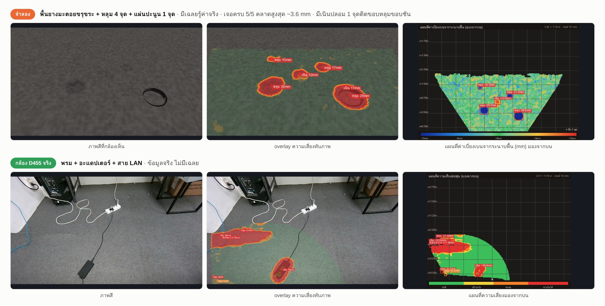
  <br><sub><b>แถวบน (จำลอง)</b> พื้นยางมะตอยขรุขระ + หลุม 4 จุด + แผ่นปะนูน — มีเฉลยรู้ค่าจริง ·
  <b>แถวล่าง (กล้อง D455 จริง)</b> พรม + ของวาง — ไม่มีเฉลย · คอลัมน์: ภาพสี → overlay ความเสี่ยง → แผนที่มองจากบน</sub>
</p>

---

## สารบัญ

1. [ระบบนี้ทำอะไร](#ระบบนี้ทำอะไร)
2. [เริ่มใช้ใน 1 นาที (ไม่ต้องมีกล้อง)](#เริ่มใช้ใน-1-นาที-ไม่ต้องมีกล้อง)
3. [การติดตั้ง](#การติดตั้ง)
4. [ใช้งานกับกล้องจริง — ทีละขั้น](#ใช้งานกับกล้องจริง--ทีละขั้น)
5. [คู่มือหน้าแดชบอร์ด](#คู่มือหน้าแดชบอร์ด)
6. [วิธีอ่านผลลัพธ์](#วิธีอ่านผลลัพธ์)
7. [สเปกหุ่น (AMR preset)](#สเปกหุ่น-amr-preset)
8. [หลักการทำงาน](#หลักการทำงาน)
9. [ความสามารถที่วัดได้จริง](#ความสามารถที่วัดได้จริง)
10. [ข้อจำกัดที่ระบบยอมรับตรง ๆ](#ข้อจำกัดที่ระบบยอมรับตรง-ๆ)
11. [ROS 2 interface](#ros-2-interface)
12. [บันทึกเซสชัน · replay · ป้ายกำกับ](#บันทึกเซสชัน--replay--ป้ายกำกับ)
13. [เรียกใช้เป็นไลบรารี Python](#เรียกใช้เป็นไลบรารี-python)
14. [โครงสร้างโปรเจกต์](#โครงสร้างโปรเจกต์)
15. [ทดสอบ](#ทดสอบ)
16. [แก้ปัญหาที่เจอบ่อย](#แก้ปัญหาที่เจอบ่อย)
17. [อ้างอิง](#อ้างอิง)

---

## ระบบนี้ทำอะไร

AMR/AGV ในโกดังวิ่งบนพื้นที่ **ไม่เคยเรียบจริง** — รอยต่อแผ่นคอนกรีตมีลิ่ม 3–5 mm, หลุมสึกลึกหลาย mm,
สายไฟ/อะแดปเตอร์ที่ตกอยู่กลางทาง ล้อ caster เล็ก ๆ แค่นี้ก็สะดุด ของบนหุ่นสั่นหรือล้มได้
แต่ตามปกติไม่มีใครรู้ว่า *จุดไหน* แย่ และ *แย่แค่ไหนสำหรับหุ่นรุ่นนี้*

`floor-inspect` ติดกล้องเดียวบนหุ่น มองพื้นข้างหน้า แล้วให้:

| ได้อะไร | รายละเอียด |
|---|---|
| **แผนที่ความเบี่ยงเบนของพื้น (mm)** | เขียว = ได้ระดับ · แดง = นูน · น้ำเงิน = ยุบ — เหมือนงานสแกนพื้นโกดังด้วยเลเซอร์ แต่ใช้กล้อง 1 ตัว |
| **รายการความผิดปกติ** | แต่ละจุดมี ชนิด · ตำแหน่ง · ขนาด · ความลึก/สูง (mm) · ความมั่นใจ (SNR) · **เหตุผลเป็นภาษาคน** |
| **คำตัดสินสำหรับหุ่นรุ่นที่เลือก** | `OK` / `WATCH` / `SLOW` / `BLOCK` พร้อมความเร็วปลอดภัยต่อจุด (m/s) — คิดจากเรขาคณิตล้อจริง ไม่ใช่แค่ตัวเลข mm |
| **ดัชนี ASTM E1155** | FF (Flatness) และ FL (Levelness) + ช่องใต้ไม้บรรทัด 600 mm / 2 m แบบ TR34/ACI |
| **overlay ทับภาพกล้อง** | ระบายสีความเสี่ยงต่อพิกเซลลงบนภาพจริง ดูแล้วรู้ทันทีว่าจุดไหนคืออะไร |
| **รายงาน** | Markdown + รูปประกอบ + ข้อมูลดิบ (`.npz`) เปิดซ้ำวิเคราะห์ใหม่ได้ภายหลัง |

### จุดเด่นที่ต่างจาก "เอา depth มาลบพื้น" ธรรมดา

- **ซื่อสัตย์กับขีดจำกัดตัวเอง** — ทุกผลมีค่า *"เล็กสุดที่ยืนยันได้"* คำนวณจาก noise ที่วัดได้จริงในเฟรมนั้น
  ถ้าเล็งกล้องผิด (ไปเล็งผนัง/กองของ) หรือผิวสะท้อนแบบกระจก ระบบ **ปฏิเสธและบอกสาเหตุ** แทนที่จะพ่นหลุมปลอมออกมา
- **เกณฑ์ปรับตามพื้นจริง** — พรม/กระเบื้องมีลายมี "เนื้อผิว" ระบบวัดเองแล้วยกเกณฑ์ตาม (บนพรมจริง: 176 จุด → 3 จุด ที่เหลือคือของวางจริงล้วน)
- **คิดตามฟิสิกส์ของล้อ** — ร่องแคบ 20 mm ลึกแค่ไหนล้อ Ø75 ก็จมได้ไม่ถึง 1.4 mm จึงไม่นับเป็นอันตราย แต่แอ่งกว้าง 15 mm ล้อจมเต็ม
- **นิ่งข้ามเฟรม** — ยืนยัน defect หลายเฟรม + ชดเชยการเลื่อนตอนหุ่นวิ่ง ผลจึงไม่กะพริบ ของจริงไม่หาย
- **ทดสอบได้โดยไม่ต้องมีกล้อง** — มีตัวจำลองพื้นพร้อมเฉลย (รู้ว่าหลุมจริงลึกกี่ mm) และเทสต์ 44 ข้อที่ล็อกพฤติกรรมทุกจุด

---

## เริ่มใช้ใน 1 นาที (ไม่ต้องมีกล้อง)

ส่วนแกนวิเคราะห์ **ไม่ผูกกับ ROS** รันได้ทันทีด้วย Python ล้วน:

```bash
git clone https://github.com/Lacrep/floor-inspect.git
cd floor-inspect
pip install -r requirements.txt

python3 -m floor_inspect.cli demo --scene warehouse --out ./demo_out
```

ผลที่ได้ (ในเครื่องผู้พัฒนาใช้เวลา ~10 วินาที):

```text
สร้างฉากจำลอง "warehouse" — กล้องสูง 0.6 m ก้ม 45.0°

พบความผิดปกติ 9 จุด · พื้นที่ 1.68 m² · เล็กสุดที่ยืนยันได้ 2.86 mm

เทียบกับเฉลยของฉาก:
   step     จริง   +3.0 mm → วัดได้   +4.2 mm (step, watch)
   pothole  จริง   -9.0 mm → วัดได้   -8.3 mm (pothole, block)
   pothole  จริง  -16.0 mm → ไม่พบ (ต่ำกว่าเกณฑ์ หรือนอกพื้นที่ที่มองเห็น)
   bump     จริง   +6.0 mm → วัดได้   +4.6 mm (bump, watch)
```

ในโฟลเดอร์ `demo_out/` จะได้ครบชุด:

| ไฟล์ | คืออะไร |
|---|---|
| `color.png` | ภาพสีของฉากจำลอง (สิ่งที่กล้องเห็น) |
| `overlay_risk.png` / `overlay_dev.png` | overlay ทับภาพ — โหมดความเสี่ยง / โหมดค่าเบี่ยงเบน (mm) |
| `topdown_risk.png` / `topdown_dev.png` | แผนที่มองจากบน |
| `profile.png` | ภาพตัดขวางตามแนวเดิน |
| `report_figure.png` | รูปสรุป 4 ช่อง |
| `report.md` | รายงานฉบับเต็ม ([ตัวอย่าง](docs/sample_report.md)) |

### ฉากที่มีให้ — 5 ฉาก มีเฉลยทุกฉาก

```bash
python3 -m floor_inspect.cli demo --scene flat       # พื้นเรียบ — ใช้ตรวจ false positive
python3 -m floor_inspect.cli demo --scene targets    # เป้ามาตรฐาน 3/5/10/20 mm (เนิน + หลุม)
python3 -m floor_inspect.cli demo --scene warehouse  # ลาดเอียง + คลื่น + ลิ่มรอยต่อ + หลุมสึก
python3 -m floor_inspect.cli demo --scene asphalt    # ยางมะตอยขรุขระ (ผิว ~2 mm) + หลุม 4 จุด + แผ่นปะนูน
python3 -m floor_inspect.cli demo --scene worn       # คอนกรีตสึก (ผิว ~1 mm) + หลุมลึก 22 / 14 / 9 mm
# ตัวเลือก: --height 0.6 --pitch 45 --cell-mm 10 --amr amr_generic|amr_small|amr_heavy|agv_tugger --out DIR
```

<table>
  <tr>
    <td width="33%">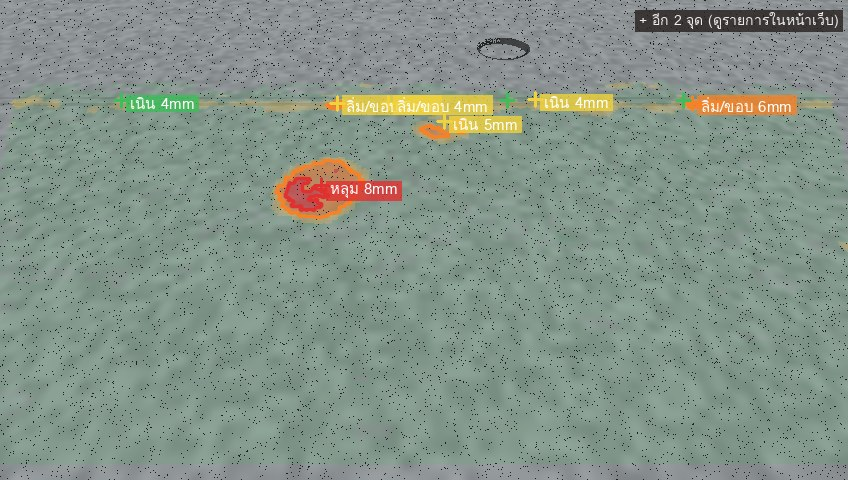<br><sub><b>warehouse</b> — หลุม 9 mm (แดง = ผ่านไม่ได้) + ลิ่มรอยต่อที่ขอบไกล</sub></td>
    <td width="33%">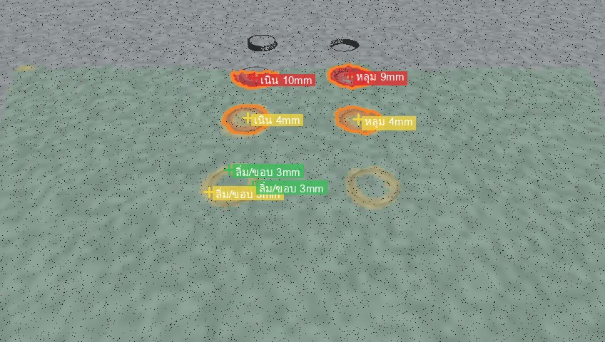<br><sub><b>targets</b> — เป้ามาตรฐาน เนินซ้าย / หลุมขวา ไล่ 10 → 5 → 3 mm จากไกลมาใกล้</sub></td>
    <td width="33%">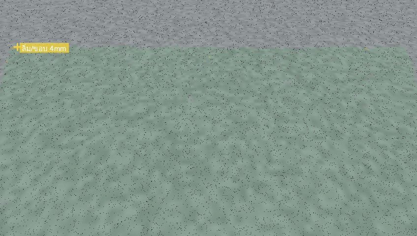<br><sub><b>flat</b> — พื้นเรียบ: 99.8% ปกติ (ดูหมายเหตุด้านล่าง)</sub></td>
  </tr>
</table>

**อ่านผลจำลองอย่างตรงไปตรงมา** (ตัวเลขจากการรันจริง ไม่ได้คัดเฉพาะที่สวย):

| ฉาก | ผล | หมายเหตุ |
|---|---|---|
| `targets` | เจอเป้า 10 mm (+10.2 / −9.1), 5 mm (+4.4 / −4.3) | เนิน 3 mm เจอ (+3.0 mm, ชนิด `step`) แต่ **หลุม 3 mm ไม่เจอ** — ต่ำกว่า "เล็กสุดที่ยืนยันได้" 2.88 mm ที่ระยะนั้น |
| `targets` | เป้า 20 mm ไม่ขึ้น | อยู่ที่ x = 1.39 m **เกินพื้นที่ที่กล้องสูง 0.6 m วัดได้** (≈ 0.2–1.2 m) ระบบไม่เดาตัวเลขนอกขอบเขต — ตั้งใจให้เป็นอย่างนี้ |
| `warehouse` | หลุม 16 mm ไม่ขึ้น | อยู่ที่ x = 1.45 m นอกพื้นที่เช่นกัน |
| `warehouse` | ลิ่มรอยต่อ (จริง 3 mm) ถูกรายงานเป็น **หลายท่อน 3.6–5.6 mm** | วัดเกินจริง ~1–2.6 mm และแตกเป็นหลายจุด เพราะลิ่มอยู่ที่ขอบไกลสุดของภาพที่ noise สูง — เป็นข้อจำกัดที่รู้อยู่ |
| `warehouse` | เนิน 6 mm วัดได้ +4.6 mm | วัดต่ำกว่าจริงเล็กน้อย (ผลของฐานอ้างอิงเฉพาะที่) |
| `asphalt` / `worn` | เจอหลุม/เนินครบ 8/8 บนผิวหยาบ | มีเนินปลอม 1 จุดข้างหลุมขอบชัน และหลุมตื้นวัดต่ำกว่าจริง 2–3 mm — ดูหัวข้อด้านล่าง |
| `flat` | พื้นเรียบ 99.8% แต่พบ **1 จุด "เฝ้าระวัง"** (+4.1 mm ที่ระยะ 1.31 m) | เป็นสัญญาณเตือนเกินจริงที่ขอบไกลสุด คำตัดสินรวมยังเป็น `OK` |


### พื้นขรุขระที่มีหลุม — ยางมะตอยและคอนกรีตสึก

ฉาก `asphalt` และ `worn` สร้างพื้นที่ **ผิวหยาบเอง** (ไม่ใช่พื้นเรียบ) แล้วเจาะหลุมหลายขนาดลงไป — ไว้ดูว่าเกณฑ์ที่ปรับตามเนื้อผิว
ยังเจอหลุมจริงโดยไม่กุจุดปลอมท่วมจอหรือเปล่า (ค่าที่ใช้อยู่ใน [`synth.py`](floor_inspect/synth.py): `scene_rough_asphalt`, `scene_worn_concrete`)

<table>
  <tr>
    <td width="50%">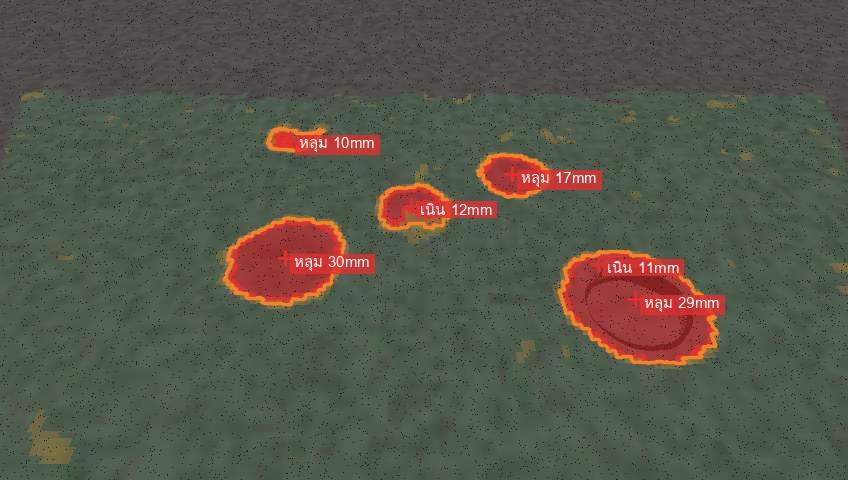<br><sub><b>asphalt</b> — overlay: หลุม 30 / 29 / 17 / 10 mm + แผ่นปะนูน 12 mm</sub></td>
    <td width="50%">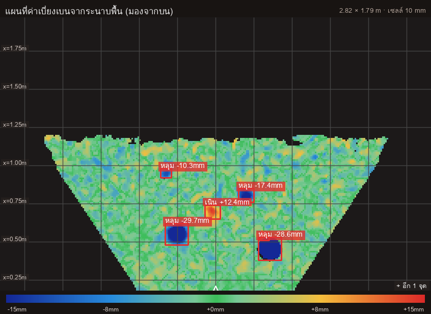<br><sub><b>asphalt</b> — แผนที่ค่าเบี่ยงเบน (mm): ผิวหยาบเป็นลายเขียว-ฟ้า หลุมเป็นน้ำเงินเข้ม เด่นขึ้นมาชัด</sub></td>
  </tr>
  <tr>
    <td>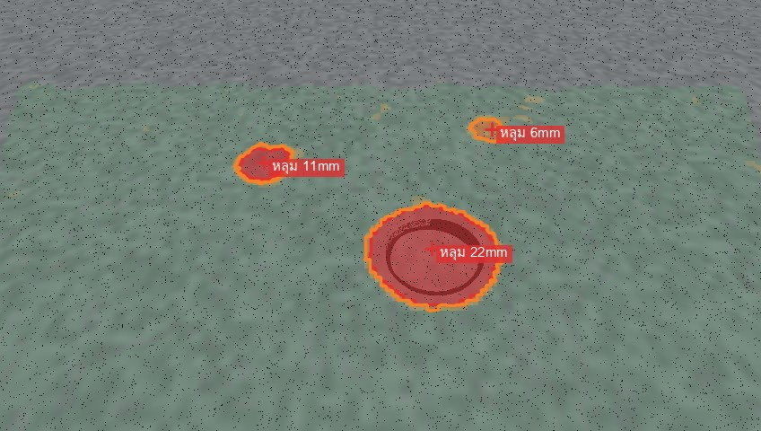<br><sub><b>worn</b> — overlay: หลุม 22 / 11 / 6 mm</sub></td>
    <td>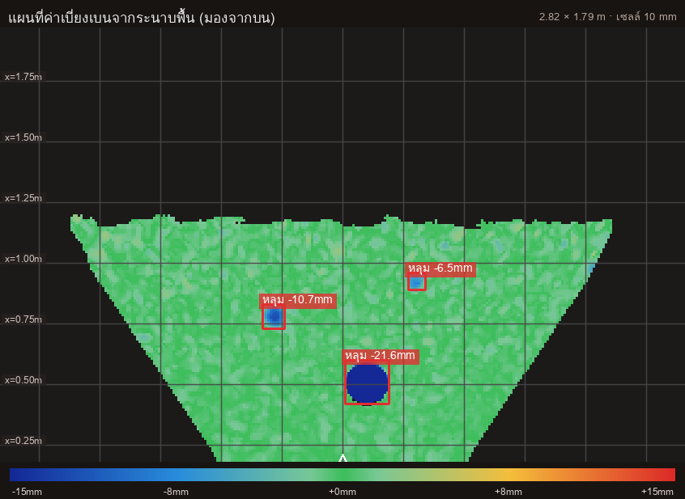<br><sub><b>worn</b> — แผนที่ค่าเบี่ยงเบน: ผิวเรียบกว่า หลุมตื้นเริ่มจางลง</sub></td>
  </tr>
</table>

<p align="center">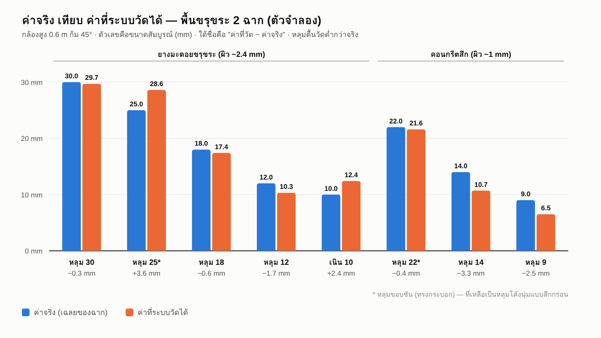</p>

| ฉาก | จุด | จริง | วัดได้ | คลาด (ขนาดที่วัด − จริง) | ผล |
|---|---|---|---|---|---|
| `asphalt` | หลุม | −30.0 mm | −29.7 mm | −0.3 | ✅ เจอ |
| `asphalt` | หลุมขอบชัน | −25.0 mm | −28.6 mm | **+3.6** (วัดลึกเกินจริง) | ✅ เจอ |
| `asphalt` | หลุม | −18.0 mm | −17.4 mm | −0.6 | ✅ เจอ |
| `asphalt` | หลุม | −12.0 mm | −10.3 mm | −1.7 (วัดตื้นกว่าจริง) | ✅ เจอ |
| `asphalt` | แผ่นปะนูน | +10.0 mm | +12.4 mm | +2.4 (วัดสูงเกินจริง) | ✅ เจอ |
| `worn` | หลุมขอบชัน | −22.0 mm | −21.6 mm | −0.4 | ✅ เจอ |
| `worn` | หลุม | −14.0 mm | −10.7 mm | −3.3 (วัดตื้นกว่าจริง) | ✅ เจอ |
| `worn` | หลุม | −9.0 mm | −6.5 mm | −2.5 (วัดตื้นกว่าจริง) | ✅ เจอ |

**อ่านผลอย่างตรงไปตรงมา:**

- **เจอครบ 8/8 บนผิวหยาบ** และฉาก `worn` ไม่มีจุดปลอมเลย — เทสต์ `test_rough_surface_potholes_found_without_ghosts` ล็อกไว้
- **ผิวหยาบทำให้ระบบ "ใจแข็งขึ้น" ตามที่ออกแบบ:** ยางมะตอยวัดเนื้อผิวได้ ~2.6 mm ทำให้ *"เล็กสุดที่ยืนยันได้"* ขยับเป็น **7.9 mm**
  (พื้นเรียบ ~2.9 mm) — หลุมตื้นกว่านี้บนผิวแบบนี้จะไม่ถูกยืนยัน ระบบเลือกเสียความไวเพื่อไม่กุหลุมปลอม
- **หลุมโค้งนุ่มตื้นถูกวัดต่ำกว่าจริง 1.7–3.3 mm** (12 → 10.3, 14 → 10.7, 9 → 6.5) ส่วนที่วัดเกินจริงมี 2 จุด: หลุมขอบชันในฉาก `asphalt` (+3.6 mm) และแผ่นปะนูน (+2.4 mm) —
  แต่หลุมขอบชันในฉาก `worn` คลาดแค่ 0.4 mm จึงสรุปเป็นกฎไม่ได้ · สาเหตุยังไม่ได้ไล่ให้ชัด ดังนั้น **อย่าใช้ตัวเลขของหลุมตื้นเป็นค่าสัมบูรณ์** ควรใช้ตัดสินระดับความเสี่ยง (ซึ่งทุกจุดนี้เกินลิมิตขั้นของหุ่นทั่วไป 7.5 mm อยู่แล้ว)
- **มีเนินปลอม 1 จุดในฉาก `asphalt`:** เนิน +10.5 mm ขนาด 50×60 mm ติดขอบนอกของหลุมขอบชัน (ในภาพ overlay คือ "เนิน 11mm" ข้างหลุม 29mm) —
  ฐานอ้างอิงเฉพาะที่ "ล้น" ตรงขอบคม เทสต์ยอมให้เกินเฉลยได้ไม่เกิน 1 จุดต่อฉาก
- **ทั้งหมดนี้เป็นตัวจำลอง** หลุมในฉากกว้าง 12–20 cm ไม่ใช่หลุมถนนจริง และยังไม่ได้เทียบกับกล้องบนพื้นขรุขระจริง

---

## การติดตั้ง

ทดสอบบน **Ubuntu 22.04 · ROS 2 Humble · Python 3.10** (numpy 1.26 · OpenCV 5.0 · SciPy 1.8)

### A) เฉพาะแกนวิเคราะห์ (ไม่ต้องมี ROS / กล้อง)

```bash
pip install -r requirements.txt          # numpy, opencv-python, scipy, matplotlib, Pillow
sudo apt install fonts-tlwg-loma-ttf     # ฟอนต์ไทยสำหรับป้ายบนภาพ (ไม่มี = ตัวอักษรไทยเป็นสี่เหลี่ยม)
python3 -m floor_inspect.cli demo --scene warehouse --out ./demo_out
```

### B) ระบบเต็ม (กล้อง + ROS 2 + หน้าเว็บ)

```bash
# 1) ROS 2 Humble + ไดรเวอร์ RealSense
sudo apt install ros-humble-realsense2-camera ros-humble-tf2-ros python3-colcon-common-extensions

# 2) ใส่แพ็กเกจลงใน workspace แล้ว build
mkdir -p ~/ros2_ws/src && cd ~/ros2_ws/src
git clone https://github.com/Lacrep/floor-inspect.git
cd ~/ros2_ws && colcon build --packages-select floor_inspect
source install/setup.bash

# 3) ไลบรารี Python ที่แกนวิเคราะห์ใช้
pip install -r src/floor-inspect/requirements.txt
sudo apt install fonts-tlwg-loma-ttf
```

> **หมายเหตุ OpenCV:** โปรเจกต์นี้ **ไม่ใช้ `cv_bridge`** (แปลงภาพ ROS ↔ numpy เอง) จึงไม่ชนกับ OpenCV เวอร์ชันใหม่
> ที่ pip ติดตั้งให้ ซึ่งเคยทำ `cv_bridge` พังบน Humble

ตรวจว่าติดตั้งสำเร็จ:

```bash
ros2 pkg executables floor_inspect
# floor_inspect floor_inspect      <- CLI (demo / bench / replay)
# floor_inspect inspect_node       <- โหนดสด + หน้าเว็บ

lsusb | grep -i intel                        # ต้องเห็นกล้อง
rs-enumerate-devices | grep -i "usb type"    # ต้องเป็น 3.x ถ้าอยากได้ความลื่นเต็มที่
```

---

## ใช้งานกับกล้องจริง — ทีละขั้น

### ขั้นที่ 1 — ติดตั้งกล้องบนหุ่น

<p align="center">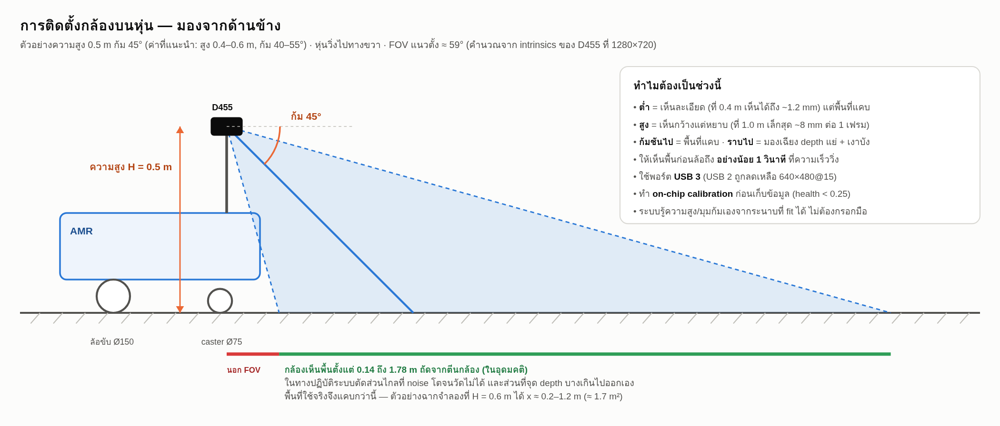</p>

| เรื่อง | คำแนะนำ | เหตุผล |
|---|---|---|
| ความสูง | **0.4–0.6 m** | ต่ำ = เห็นละเอียด (ที่ 0.4 m เห็นได้ถึง ~1.2 mm) · สูง = เห็นกว้างแต่หยาบ |
| มุมก้ม | **40–55°** จากแนวนอน | ชันไป = พื้นที่แคบ · ราบไป = มองเฉียงจน depth แย่และเกิดเงาบัง |
| ทิศทาง | มองไปข้างหน้าตามทางเดิน | ให้เห็นพื้นก่อนล้อถึงอย่างน้อย 1 วินาทีที่ความเร็ววิ่ง |
| USB | พอร์ต **USB 3** (ช่องสีฟ้า / มีสัญลักษณ์ SS) | USB 2 ถูกลดเหลือ 640×480@15 อัตโนมัติ — ใช้ได้แต่ช้าลง |
| สอบเทียบ | ทำ **on-chip calibration** ของ D455 ก่อนเก็บข้อมูลจริง | ค่า health ควรอยู่ในช่วง GOOD (< 0.25) |

ไม่ต้องกรอกความสูง/มุมก้มเอง — ระบบอ่านจากระนาบพื้นที่ fit ได้ (มุมก้มเสริมด้วย IMU ของกล้อง)

### ขั้นที่ 2 — เปิดระบบ (คำสั่งเดียว)

```bash
export ROS_WS=~/ros2_ws                     # workspace ที่ build ไว้ (ค่าเริ่มต้น ~/ros2_ws)
./scripts/run_floor_inspect.sh              # โหมดสมดุล (balanced) + หุ่นทั่วไป
```

สคริปต์จะ: ตรวจว่าเห็นกล้องบน USB → รายงาน USB 2/3 → ล้างโหนดเก่าที่ค้าง → `ros2 launch` กล้อง + โหนดวิเคราะห์ → เปิดหน้าเว็บที่ **http://localhost:8770/**

**ตัวเลือกของสคริปต์**

```bash
./scripts/run_floor_inspect.sh                        # balanced + amr_generic
./scripts/run_floor_inspect.sh detail                 # ละเอียดสุด (เล็กสุด 1.6 mm) — ใช้ตอนจอดนิ่ง
./scripts/run_floor_inspect.sh smooth amr_small       # ลื่นสุด + สเปกหุ่นเล็ก
GLARE=1  ./scripts/run_floor_inspect.sh detail        # เปิด HDR สู้พื้นมันวาว/แสงสะท้อน
CARPET=1 ./scripts/run_floor_inspect.sh detail        # พื้นพรม — ยกเกณฑ์หลุมกัน "หลุมผี"
POTHOLE=15 BUMP=8 ./scripts/run_floor_inspect.sh      # ตั้งเกณฑ์เองทีละค่า (mm)
LASER=90 AE_LIMIT=8000 ./scripts/run_floor_inspect.sh # ปรับกล้องเอง
```

หรือสั่งผ่าน `ros2 launch` ตรง ๆ:

```bash
ros2 launch floor_inspect inspect.launch.py quality:=detail amr:=amr_small
ros2 run floor_inspect inspect_node          # ถ้าเปิดกล้องไว้แล้วด้วยตัวเอง
```

<details>
<summary><b>launch arguments ทั้งหมด</b></summary>

| argument | ค่าเริ่มต้น | ความหมาย |
|---|---|---|
| `quality` | `balanced` | `smooth` \| `balanced` \| `detail` (ดูตารางโหมดภาพด้านล่าง) |
| `amr` | `amr_generic` | `amr_generic` \| `amr_small` \| `amr_heavy` \| `agv_tugger` |
| `glare` | `false` | `true` = เปิด HDR สู้พื้นมันวาว |
| `laser_power` | `150` | 0–360 · ลดถ้าจุดสะท้อนบานเป็นรู · เพิ่มถ้าพื้นด้านมืด |
| `ae_limit_us` | `20000` | เพดานเวลาเปิดหน้ากล้องของ depth (µs) |
| `power_line_hz` | `50` | ความถี่ไฟบ้าน 50 (ไทย) \| 60 \| 0 ปิด \| −1 ไม่ยุ่ง |
| `pixel_stride` | (ตามโหมด) | 1 = ละเอียดสุด · 2 = เร็วขึ้นเท่าตัว |
| `cell_mm` | `10` | ขนาดเซลล์ DEM |
| `pothole_mm` / `bump_mm` | `4` / (เท่า pothole) | เกณฑ์หลุม/เนินขั้นต่ำ (mm) |
| `zmax` | `3.0` | ตัดจุดที่ไกลกว่านี้ (m) |
| `interval` | `0.0` | 0 = เร็วสุดเท่า CPU ไหว · >0 = จำกัดคาบ (วินาที) |
| `camera_ns` | `/camera/camera` | namespace ของไดรเวอร์กล้อง |
| `start_camera` | `true` | `false` = ไม่เปิดกล้องให้ (มีไดรเวอร์รันอยู่แล้ว) |

</details>

### โหมดภาพ — เลือกระหว่าง "ลื่น" กับ "ละเอียด"

ตัวเลขวัดจริงบนเครื่องพัฒนา ซึ่งต่อกล้องผ่าน **USB 2.1** (คอขวดหลัก):

| โหมด | depth | color | สตรีม | วิเคราะห์ | เล็กสุดที่เชื่อได้ | พื้นที่/เฟรม |
|---|---|---|---|---|---|---|
| `smooth`   | 640×480 @30  | 640×480 @30  | 30 Hz  | ~7 fps  | 3.9 mm | 2.6 m² |
| `balanced` | 848×480 @10  | 1280×720 @10 | 9.1 Hz | ~11 fps | 2.5 mm | 3.0 m² |
| `detail`   | 1280×720 @5  | 1280×720 @5  | 4.4 Hz | ~5 fps  | **1.6 mm** | 3.5 m² |

`balanced` ชนะเกือบทุกด้าน จึงเป็นค่าเริ่มต้น · ใช้ `detail` ตอนจอดนิ่งแล้วกดสแกน ·
ถ้าเสียบ **USB 3** จะได้ 848×480 ถึง 90 Hz และ 1280×720 ที่ 30 Hz (ตัวเลขข้างบนเป็นเพดานของ USB 2)

### ขั้นที่ 3 — เล็งกล้องให้ผ่านเกณฑ์ก่อน

ระบบ **ไม่ยอมรายงานตัวเลข** ถ้าระนาบที่จับได้ยังไม่เรียบพอจะเป็นพื้น (กันนับ "หลุมปลอม" ตอนกล้องเล็งผนัง/กองของ)
เปิดตัวช่วยเล็งไว้อีกหน้าต่างหนึ่ง:

```bash
./scripts/aim_check.sh
# ยังไม่ผ่าน | สูง 2.43 m | ก้ม -175.9° | rms 17.95 mm (ต้อง < 12) | inlier 0.52 (ต้อง > 0.6) | fill 71%
# พร้อม     | สูง 0.92 m | ก้ม 50.8° | rms 3.96 mm | fill — | พื้นที่ 0.80 m² | เนื้อผิว 7.25 mm | เล็กสุด 10.57 mm | จุดผิดปกติ 6
```

ค่อย ๆ ก้มกล้องลงจนบรรทัดขึ้น **`พร้อม`** แล้วค่อยอ่านผล — เกณฑ์ผ่านคือ `rms < 12 mm` และ `inlier > 0.6`
(ค่าชุดเดียวกันดึงเป็น JSON ได้ที่ `http://localhost:8770/state.json` สำหรับสคริปต์/CI)

### ขั้นที่ 4 — เปิดหน้าเว็บ แล้วอ่านผล

เปิด **http://localhost:8770/** → ดู [คู่มือหน้าแดชบอร์ด](#คู่มือหน้าแดชบอร์ด) ด้านล่าง

### ขั้นที่ 5 — สแกนละเอียดตอนจอดนิ่ง (ถ้าต้องการ)

กดปุ่ม **"สแกนละเอียด (จอดนิ่ง)"** → ระบบสะสม DEM หลายเฟรม (ค่าเริ่มต้น 12 ปรับด้วย `scan_frames`) ลด noise แบบสุ่มได้มาก:
ในตัวจำลอง การสะสม 8 เฟรมทำให้เล็กสุดที่เห็นที่กล้องสูง 0.6 m ลดจาก 3.49 → **1.47 mm** ([ดูกราฟ](#ความสามารถที่วัดได้จริง))

### ขั้นที่ 6 — บันทึกและออกรายงาน

พิมพ์ชื่อจุดที่วัด (เช่น `aisle-A-01`) → **บันทึกเซสชัน** (เก็บ DEM ดิบ + ภาพ + meta) หรือกด **รายงาน**
ได้ Markdown พร้อมใช้ · เปิดเซสชันกลับมาวิเคราะห์ซ้ำด้วยเกณฑ์ใหม่ได้ ดู [บันทึกเซสชัน](#บันทึกเซสชัน--replay--ป้ายกำกับ)

---

## คู่มือหน้าแดชบอร์ด

ภาพด้านล่างคือ **หน้าเว็บตัวจริง** (`HTML_PAGE` ของโหนด) ที่ป้อนด้วยผลวิเคราะห์จากเซสชันกล้องจริงชุดพรม

> **ที่มาของภาพ (บอกตรง ๆ):** ถ่ายตอนไม่ได้เสียบกล้อง จึงรันเซิร์ฟเวอร์จำลองที่เสิร์ฟหน้าเว็บตัวเดียวกัน
> แล้วป้อน `meta.json` + ภาพ overlay/แผนที่ที่บันทึกไว้จากกล้องจริง ฟิลด์ที่เซสชันไม่ได้เก็บ (มุมก้ม, noise, เนื้อผิว)
> คำนวณใหม่จาก `dem.npz` ของเซสชันเดียวกัน ส่วน `fill` และ `fps` ที่เก็บไม่ได้ปล่อยว่าง — ตัวเลขจึงเป็นของจริงทั้งหมด
> แต่เป็น **ภาพนิ่งของผลที่บันทึกไว้** ไม่ใช่ภาพสดจากการรันครั้งนั้น

<p align="center">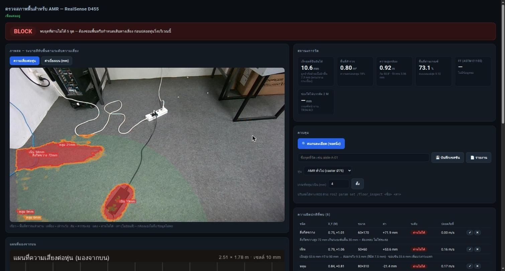</p>

| ส่วน | ใช้ทำอะไร |
|---|---|
| **① แถบคำตัดสิน** (บนสุด) | `OK` เขียว · `WATCH` เหลือง · `SLOW` ส้ม · `BLOCK` แดง + ข้อความแนะนำที่ทำได้จริง เช่น "พบจุดที่ผ่านไม่ได้ 5 จุด — ต้องซ่อมพื้นหรือกำหนดเส้นทางเลี่ยง" |
| **② ภาพสด** | ภาพสีทับ overlay · สลับโหมด **ความเสี่ยงต่อหุ่น** ↔ **ค่าเบี่ยงเบน (mm)** · ใต้ภาพมีคำอธิบายสี |
| **③ สถานะการวัด** | **เล็กสุดที่ยืนยันได้** (mm) · **พื้นที่สำรวจ** (m²) · **ความสูงกล้อง** + มุมก้ม + rms ของระนาบ · **พื้นที่ผ่านเกณฑ์** (%) · FF (ASTM E1155) · ช่องใต้ไม้บรรทัด 2 m |
| **④ ควบคุม** | ปุ่มสแกนละเอียด · ช่องชื่อจุด + บันทึกเซสชัน + รายงาน · **เลือกสเปกหุ่น** · **เกณฑ์หลุม/เนิน (mm)** ปรับสดไม่ต้องรีสตาร์ต |

<p align="center">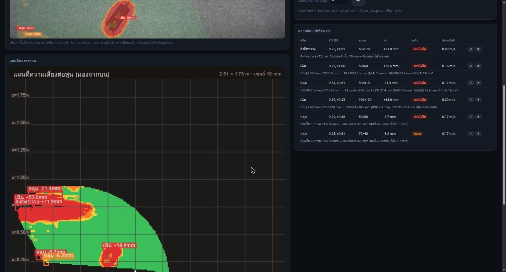</p>

| ส่วน | ใช้ทำอะไร |
|---|---|
| **⑤ ตารางความผิดปกติ** | ทุกจุด: ชนิด · X,Y (m) จากตีนกล้อง · ขนาด (มม.) · ค่า · **ระดับ** · **ความเร็วปลอดภัย** + บรรทัดเหตุผล เช่น *"หลุมลึก 21.4 mm กว้าง 80 mm → ล้อ caster Ø75 mm จมจริง 21.4 mm (ลิมิต 7.5 mm)"* |
| **ปุ่ม ✓ / ✕** | คนตรวจกดยืนยัน/ปฏิเสธทีละจุด → บันทึกลง `annotations.csv` เพื่อคำนวณ precision/recall ภายหลัง |
| **⑥ แผนที่มองจากบน** | มุมมองจากบนของพื้นที่ที่วัดได้ ตารางเมตร (x = ระยะข้างหน้า) — วาดจาก DEM ล้วน ๆ ไม่มีภาพสีมากวน เหมาะใช้ตัดสินว่า "ตรวจมั่วหรือเปล่า" |
| **⑦ ภาพตัดขวาง** | โปรไฟล์ความสูงตามแนวเดินที่ y ที่เลือก (ใส่ค่าในช่อง) |

> **วิธีตัดสินว่าระบบ "มั่ว" หรือไม่:** ดูแผนที่มองจากบน — ถ้าพื้นส่วนใหญ่เขียวและแดงกระจุกตรงที่มีของวางอยู่จริง
> แปลว่าเรขาคณิตถูก ไม่ใช่การตรวจมั่ว (พื้นจริงที่มีสายไฟ/อะแดปเตอร์จะได้ 30–40 จุดต่อเฟรม ซึ่งแต่ละจุดถูกต้อง
> ภาพ overlay จึงเขียนป้ายเฉพาะ `max_labels` จุดที่เสี่ยงสุด ที่เหลือขึ้นกากบาทและ "+ อีก N จุด")

### Endpoint ของหน้าเว็บ (เรียกจากสคริปต์ได้)

| Endpoint | วิธี | ได้อะไร |
|---|---|---|
| `/` | GET | หน้าแดชบอร์ด |
| `/state.json` | GET | สถานะล่าสุดเป็น JSON (ไม่รวมภาพ) — ใช้เช็คจาก `curl`/CI |
| `/state` | GET (SSE) | สตรีมสถานะทุก ~0.3 วินาที |
| `/mjpeg` · `/mjpeg/topdown` · `/mjpeg/profile` | GET | สตรีมภาพ overlay / แผนที่มองจากบน / ภาพตัดขวาง |
| `/report` | GET | รายงาน Markdown ของผลล่าสุด |
| `/sessions` | GET | รายการเซสชันที่บันทึกไว้ |
| `/scan` · `/save` · `/param` · `/annotate` | POST | สแกน / บันทึกเซสชัน / ปรับพารามิเตอร์ / บันทึกป้ายกำกับ |

```bash
curl -s localhost:8770/state.json | python3 -m json.tool | head -30
curl -s -X POST localhost:8770/param -H 'Content-Type: application/json' \
     -d '{"name":"pothole_mm","value":6.0}'
```

---

## วิธีอ่านผลลัพธ์

### ชนิดของความผิดปกติ

| ชนิด (`kind`) | ภาษาในหน้าเว็บ | คืออะไร | วัดเทียบกับ |
|---|---|---|---|
| `pothole` | หลุม | ผิวพื้นยุบลงไป | ฐานอ้างอิงเฉพาะที่ (ตัดความลาด/คลื่นยาวออก) |
| `bump` | เนิน | ผิวพื้นนูนขึ้น | ฐานอ้างอิงเฉพาะที่ |
| `step` | ลิ่ม / ขอบต่างระดับ | ขอบคมที่ล้อกระแทกโดยตรง (รอยต่อแผ่นพื้น) — อันตรายกว่าแอ่งลาดที่ลึกเท่ากัน | ผลต่างความสูงสองข้างขอบ |
| `obstacle` | สิ่งกีดขวาง | **ของที่วางอยู่บน**พื้น (สูง ≥ `obstacle_mm` = 60 mm) | **ระนาบพื้น** (สูงจากพื้นเท่าไร) — ไม่ใช่ฐานเฉพาะที่ |
| `missing` | ไม่มีข้อมูล | บริเวณที่ stereo อ่านไม่ได้ (หลุมลึก ผิวสะท้อน ท่อระบายน้ำ) | — รายงานแยกเสมอ **ไม่ถือว่าพื้นเรียบ** |

### ระดับความเสี่ยงต่อหุ่น

คะแนนความเสี่ยงต่อเซลล์ถูกแบ่งเป็น 4 ระดับ (เกณฑ์ `LEVEL_TH` ใน `risk.py`):

| ระดับ | คะแนน | สี | ความหมาย |
|---|---|---|---|
| `ok` ปกติ | < 0.35 | 🟩 เขียว | ผ่านได้ความเร็วปกติ |
| `watch` เฝ้าระวัง | 0.35 – 0.65 | 🟨 เหลือง | ผ่านได้ แต่ควรเฝ้าดู |
| `slow` ชะลอ | 0.65 – 1.00 | 🟧 ส้ม | ผ่านได้ **ต้องลดความเร็ว** (มี `safe_speed_ms` ต่อจุด) |
| `block` ผ่านไม่ได้ | ≥ 1.00 | 🟥 แดง | เกินลิมิตของล้อ/ตัวหุ่น — ต้องซ่อมหรือเลี่ยง |

### คำตัดสินรวม (แถบบนสุดของหน้าเว็บ)

| คำตัดสิน | เงื่อนไข |
|---|---|
| **BLOCK** | มี defect ระดับ `block` อย่างน้อย 1 จุด |
| **SLOW** | ไม่มี block แต่มี defect ระดับ `slow` — ข้อความบอกความเร็วที่ควรลดเหลือ |
| **WATCH** | ไม่มี block/slow แต่พื้นที่ผ่านเกณฑ์ < 95% (ผิวไม่เรียบกระจายอยู่) |
| **OK** | ที่เหลือ — พื้นเรียบพอสำหรับหุ่นรุ่นนี้ |

### ตัวอย่างผลจากกล้องจริง (พรม + ของวาง)

<table>
  <tr>
    <td width="50%">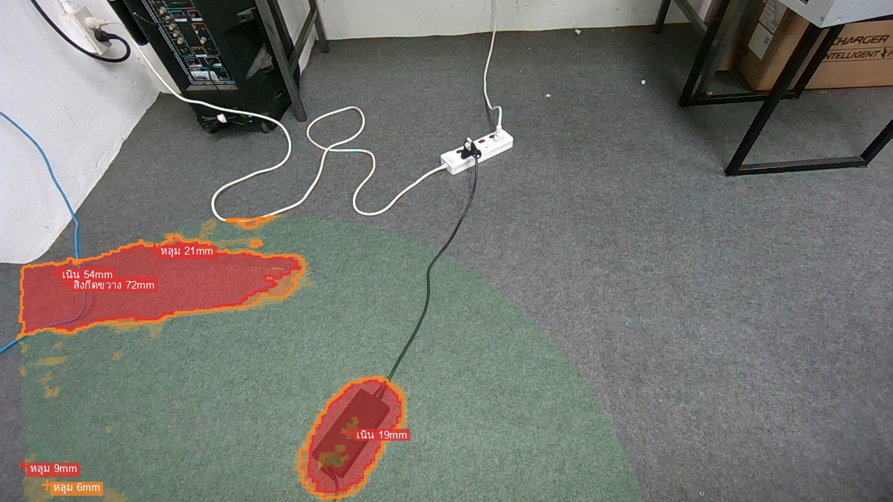<br><sub>overlay ทับภาพกล้อง — อะแดปเตอร์ดำด้านล่างถูกระบุเป็นเนิน 19 mm ตรงจุด · ส่วนแดงใหญ่ที่ขอบซ้ายคือวัตถุสีขาว (ดูเหมือนผนัง/แผ่นชิดพื้น) กับสาย LAN สีน้ำเงิน ซึ่งระบบนับเป็นสิ่งกีดขวางสูง 72 mm</sub></td>
    <td width="50%">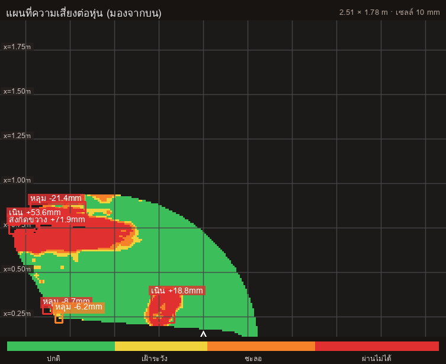<br><sub>แผนที่มองจากบนของเฟรมเดียวกัน — เขียว = ปกติ, แดง = ผ่านไม่ได้ · ตำแหน่ง x,y ตรงกับตารางในหน้าเว็บ</sub></td>
  </tr>
</table>

### รายงาน Markdown ที่ได้

รายงานฉบับเต็มมี 4 ส่วน: (1) เงื่อนไขการวัด (2) ดัชนีความเรียบ FF/FL + ช่องใต้ไม้บรรทัด
(3) ความเสี่ยงต่อหุ่น + พื้นที่แยกตามระดับ (4) รายการความผิดปกติ + **เหตุผลรายจุด**
ดูตัวอย่างจริงที่ [`docs/sample_report.md`](docs/sample_report.md) และรูปสรุปที่ได้พร้อมกัน:

<p align="center">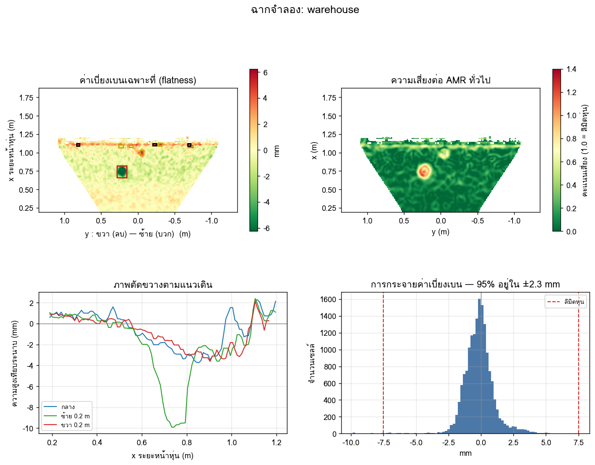</p>

<sub>ซ้ายบน: แผนที่ค่าเบี่ยงเบนเฉพาะที่ · ขวาบน: ความเสี่ยงต่อ AMR · ซ้ายล่าง: ภาพตัดขวางตามแนวเดิน (กลาง / ซ้าย 0.2 m / ขวา 0.2 m) · ขวาล่าง: การกระจายค่าเบี่ยงเบน เทียบลิมิตหุ่น</sub>

---

## สเปกหุ่น (AMR preset)

ผลการตัดสินขึ้นกับหุ่น — ล้อ caster เล็กกว่าเสมอ จึงเป็นตัวจำกัดจริง (ขั้นสูงสุดที่ผ่านได้ราบรื่น = 10% ของ Ø caster)

| preset | ชื่อ | ล้อขับ Ø | caster Ø | ขั้นสูงสุด | ระยะพ้นพื้น | ลาดสูงสุด | ความเร็ว | สั่นแนวดิ่งสูงสุด |
|---|---|---|---|---|---|---|---|---|
| `amr_generic` | AMR ทั่วไป *(ค่าเริ่มต้น)* | 150 mm | 75 mm | **7.5 mm** | 30 mm | 5.0° | 1.2 m/s | 2.0 m/s² |
| `amr_heavy` | AMR ขนของหนัก | 200 mm | 100 mm | **10.0 mm** | 40 mm | 4.0° | 1.0 m/s | 1.5 m/s² |
| `amr_small` | AMR เล็ก/ส่งของ | 100 mm | 50 mm | **5.0 mm** | 20 mm | 6.0° | 1.5 m/s | 2.5 m/s² |
| `agv_tugger` | AGV ลากจูง | 250 mm | 125 mm | **12.5 mm** | 50 mm | 3.0° | 1.8 m/s | 1.2 m/s² |

**เพิ่มสเปกหุ่นของตัวเอง** — เพิ่มรายการใน `PRESETS` ที่ [`floor_inspect/risk.py`](floor_inspect/risk.py):

```python
'my_robot': AMRSpec(name='หุ่นของฉัน', drive_wheel_d_m=0.12, caster_d_m=0.06,
                    ground_clearance_m=0.025, track_width_m=0.40,
                    max_slope_deg=5.0, max_speed_ms=1.0, accel_limit_ms2=2.0),
```

แล้วเรียกด้วย `amr:=my_robot` (ถ้าจะให้ปุ่มเลือกในหน้าเว็บขึ้นชื่อนี้ด้วย ให้เพิ่มใน `<select id="spec">` ของ `dashboard_html.py`)

---

## หลักการทำงาน

### ท่อประมวลผล

<p align="center">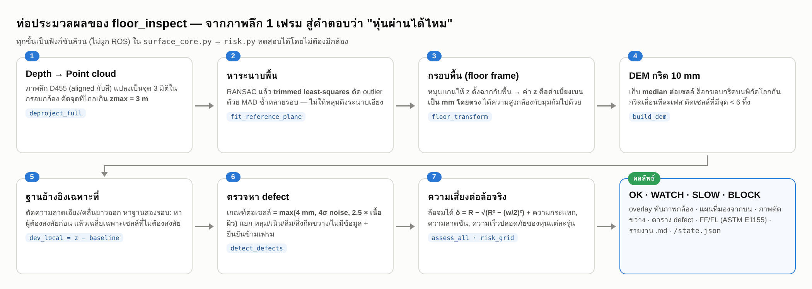</p>

### ทำไมระยะสำคัญมาก — noise ของ stereo โตตาม ระยะ²

D455 วัดความลึกด้วยกล้อง IR คู่ (stereo) ความคลาดเคลื่อนโตตามกำลังสองของระยะ —
ที่ 0.5 m noise ต่อจุด ~0.5 mm แต่ที่ 1.8 m เกิน 6 mm กราฟด้านล่างวัดจากกล้องจริง (USB 2, 640×480):

<p align="center">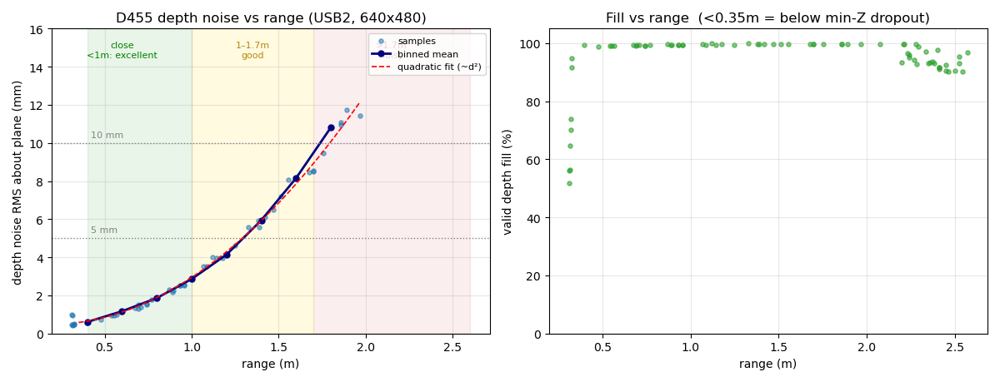</p>

ผลคือ **เกณฑ์ตัดสิน defect ต้องปรับตามระยะ** ถ้าใช้เกณฑ์เดียวทั้งภาพจะได้ false positive ที่ระยะไกลเป็นร้อยจุด
ระบบจึงวัด noise จากข้อมูลเอง แล้วตั้งเกณฑ์ต่อเซลล์เป็น

```
เกณฑ์ต่อเซลล์ = max( ค่าคงที่ 4 mm ,  4 × noise ของเซนเซอร์ ,  2.5 × เนื้อผิวของพื้นตรงนั้น )
```

### สี่จุดที่ทำให้ผลเชื่อถือได้ (ทุกข้อมี regression test)

1. **ระนาบอ้างอิงต้องไม่โดนหลุมดึง** — RANSAC ธรรมดานับหลุม 5 mm เป็น inlier แล้วระนาบเอียงเพี้ยนหลาย mm ที่ปลายกริด
   จึง refine ด้วย trimmed least-squares ตัด outlier ด้วย MAD ซ้ำหลายรอบ
2. **threshold ต้องปรับตาม noise จริงของแต่ละจุด** — (ดูหัวข้อด้านบน)
3. **ฐานอ้างอิงเฉพาะที่ต้องมาจากพื้นดีเท่านั้น** — top-hat ล้วน ๆ พังสองแบบ: ความลึกเหลือครึ่งเดียว และเกิด "เนินปลอม"
   ตรงพื้นดีระหว่างหลุมสองใบที่อยู่ใกล้กัน แก้ด้วยการหาฐานสองรอบ (หาผู้ต้องสงสัยก่อน แล้วเฉลี่ยเฉพาะเซลล์ที่ไม่ต้องสงสัย)
4. **มิลลิเมตรอย่างเดียวตัดสินไม่ได้ ต้องดูความกว้าง** — ดูหัวข้อถัดไป

### ความลึกอย่างเดียวบอกอะไรไม่ได้ — ต้องคิดจากเรขาคณิตล้อ

ร่องกว้าง 20 mm ลึก 30 mm ล้อ Ø75 **คร่อมข้ามฉิว ๆ** (จมแค่ ~1.4 mm) แต่แอ่งกว้าง 100 mm ลึก 15 mm ล้อจมเต็ม 15 mm
ระบบคำนวณ `δ = R − √(R² − (w/2)²)` จริง (`risk.wheel_drop_mm`)

<p align="center">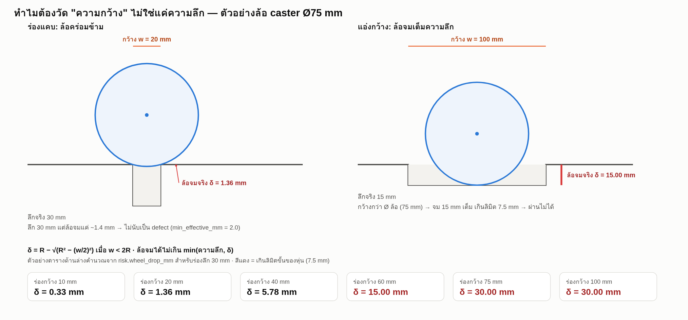</p>

### ท่ายืนยันผลข้ามเฟรม — ผลต้องไม่กะพริบ ของจริงต้องไม่หาย

ระบบ fit ใหม่ทุกเฟรม ถ้าไม่ระวังจะได้ผลที่เด้งไปมาทั้งที่ฉากไม่ขยับ จึงมีกลไกรวม 6 อย่าง
(ชั้นควอนไทล์ของเนื้อผิว · EMA ของค่า fit · พื้นที่สำรวจแบบก้อนใหญ่สุด · ยืนยัน defect 3 ใน 5 เฟรม ·
ล็อกขอบกริดบนพิกัดโลก · ตัดเซลล์ที่จุด depth บางเกิน) วัดจริงกับกล้องนิ่ง 20 เฟรม:

| ค่า | ก่อนแก้ (sd) | หลังแก้ (sd) |
|---|---|---|
| `area_m2` พื้นที่สำรวจ | 0.72 | **0.06** |
| `rough_mm` เนื้อผิว | 5.79 | **0.13** |
| `detectable_mm` เล็กสุดที่เชื่อได้ | 11.96 | **0.40** |
| `n_defects` จำนวนจุด | 5.78 | **1.38** |

และ **ตอนหุ่นวิ่ง** พิกัด defect เลื่อนทุกเฟรม ตัวยืนยันจะกลบของจริงทิ้งถ้าไม่ชดเชย — ระบบวัดการเลื่อนของพื้นจาก DEM
ด้วย phase correlation แล้วตรวจซ้ำด้วย NCC (เฟรมที่วัดถูก NCC 0.67–0.86 · วัดผิด ≤ 0.00 แยกขาดกัน)
รายละเอียดและตัวเลขเต็มอยู่ใน [`docs/TECHNICAL_NOTES.md`](docs/TECHNICAL_NOTES.md)

### พื้นที่มีเนื้อผิว (พรม กระเบื้องมีลาย) — ตัวเลขจากพรมจริง

| | ก่อน | หลัง |
|---|---|---|
| จุดที่รายงาน (เฟรมเดียว กล้องสูง 0.92 m) | 176 | **39** (เพิ่มเกณฑ์เนื้อผิว) → **3** (ตัดบริเวณที่วัดไม่ได้ออก) |
| พื้นที่ที่อ้างว่าสำรวจ | 3.17 m² | 0.70 m² (เท่าที่วัดได้จริง) |

ที่เหลือคือของจริงล้วนตามที่ผู้พัฒนาตรวจด้วยตา (สายไฟ ปลั๊กพ่วง อะแดปเตอร์ ขาโต๊ะ ผนัง — รายละเอียดใน [TECHNICAL_NOTES](docs/TECHNICAL_NOTES.md)) · ถ้ายังเจอ "หลุมผี" บนพรมเรียบ ใช้ `CARPET=1`
(ยกเกณฑ์หลุมเป็น 20 mm คงเกณฑ์เนินไว้ที่ 4 mm) — **ราคาที่ต้องจ่าย:** หลุมจริงลึกต่ำกว่า 20 mm บนพรมจะถูกมองข้าม
เพราะที่ระยะ 1–2 m บนพรม กล้องตัวนี้แยกหลุม 15 mm ออกจากหางความผิดพลาดของตัวเองไม่ได้ ต้องลดระยะ ไม่ใช่ลดเกณฑ์

---

## ความสามารถที่วัดได้จริง

วัดด้วย `bench` กับฉากที่รู้เฉลย (กล้องก้ม 45° · เซลล์ 10 mm · ความหยาบผิว 0.3 mm):

```bash
python3 -m floor_inspect.cli bench --heights 0.4,0.6,0.8 --frames 8
```

<p align="center">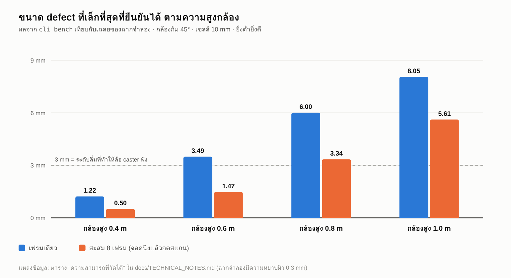</p>

| ความสูงกล้อง | พื้นที่/เฟรม | เล็กสุดที่เห็นได้ (1 เฟรม) | เล็กสุด (สะสม 8 เฟรม) | RMSE (1 / 8 เฟรม) | recall (1 / 8) |
|---|---|---|---|---|---|
| 0.40 m | 1.72 m² | 1.22 mm | **0.50 mm** | 0.63 / 0.32 mm | 75% / 75% |
| 0.60 m | 3.58 m² | 3.49 mm | **1.47 mm** | 1.69 / 0.69 mm | 83% / 83% |
| 0.80 m | 5.25 m² | 6.00 mm | **3.34 mm** | 2.41 / 0.90 mm | 67% / 83% |
| 1.00 m | 5.29 m² | 8.05 mm | **5.61 mm** | 3.85 / 1.31 mm | 42% / 83% |

ความคลาดเคลื่อนเฉลี่ย (bias) อยู่ระหว่าง −0.31 ถึง +0.12 mm ทุกเงื่อนไข — **แทบไม่มีอคติเชิงระบบ** ความผิดพลาดที่เหลือเป็นแบบสุ่มล้วน
จึงเป็นเหตุผลที่การสะสมเฟรมได้ผลดี (ที่ 1.0 m การตรวจพบกระโดดจาก 42% เป็น 83%)

> **สรุปที่ใช้ตัดสินใจได้:** ต้องการเห็นลิ่ม 3 mm (ระดับที่ทำล้อ caster พัง) → ตั้งกล้องสูงไม่เกิน **0.5 m** และใช้โหมดสแกนสะสมตอนจอดนิ่ง

> ตัวเลขชุดนี้มาจาก**ตัวจำลอง**ที่ออกแบบให้ noise สัมพันธ์กันเชิงพื้นที่เหมือน block-matching ของ D455 (ไม่ใช่ noise อิสระที่ทำให้ผลดูดีเกินจริง)
> แต่ยังไม่ใช่การวัดบนพื้นโกดังจริงที่มีเฉลย — ดู [ข้อจำกัด](#ข้อจำกัดที่ระบบยอมรับตรง-ๆ)

---

## ข้อจำกัดที่ระบบยอมรับตรง ๆ

ระบบถูกออกแบบให้ **บอกว่าตัวเองรู้อะไรไม่รู้อะไร** แทนที่จะเดาตัวเลขออกมา:

- **FL (Levelness) ต้องมีเส้นวัดยาว ≥ 3.048 m** ตามมาตรฐาน กล้องตัวเดียวเห็นแค่ ~2 m →
  ระบบคืน `None` พร้อมเหตุผล ถ้าต้องการ FL จริงต้องต่อภาพหลายจุด (mosaic — ยังไม่ได้ทำ)
- **บริเวณที่ไม่มีข้อมูล depth ≠ พื้นเรียบ** — รายงานแยกเป็นชนิด `missing` เสมอ
- **ถ้าระนาบที่จับได้ไม่เรียบพอ (rms > 12 mm)** ระบบบอกว่า "ยังไม่ได้เล็งพื้น" ไม่พ่นรายการหลุมปลอม
- **สำรวจได้ < 0.15 m²** ก็ปฏิเสธ — ผิวเรียบผืนจิ๋วใกล้เลนส์ผ่านเกณฑ์ rms ได้ แล้วจะกลายเป็น "ตรวจแล้วไม่พบอะไร" ทั้งที่แทบไม่ได้ตรวจ
- **ผิวเคลือบเงาแบบกระจก** (โต๊ะลงแลกเกอร์ อีพ็อกซีขัดเงามาก กระเบื้องโพลิช กระจก ผิวน้ำ) — กล้องวัดได้แค่ "เงาสะท้อนของเพดาน" ไม่ใช่ตัวผิว
  **ไม่มีค่ากล้องตัวไหนแก้ได้** (กวาด laser/AE/HDR แล้ว) ระบบตรวจลายเซ็นนี้แล้วปฏิเสธพร้อมบอกวิธีแก้ (ปูกระดาษ/เทปด้าน หรือดับไฟที่สะท้อน)
  ผิวที่ใช้ได้ดี: คอนกรีตขัดหยาบ อีพ็อกซีผิวด้าน พรม กระเบื้องยาง แผ่นโฟม — ครอบคลุมพื้นโกดังเกือบทั้งหมด
- **ความผิดปกติที่กว้างกว่า `base_win_m` (0.40 m)** จะโผล่ในแผนที่ระดับรวม ไม่ใช่แผนที่ flatness — ตรงตามนิยาม FF vs FL ของ ASTM
- **ของขนาดใหญ่ใกล้กล้องมาก** (ในฉากจำลอง: รัศมี ≥ 0.14 m ที่กล้องสูง 0.9 m) RANSAC อาจ fit ระนาบบนหลังกล่องแทนพื้น — ยังไม่ได้แก้ ไม่เกิดในการใช้งานจริงที่พื้นกินเฟรมมากกว่าของ
- **การชดเชยตอนหุ่นวิ่ง** ยืนยันกับกล้องจริงแล้วเฉพาะตอนกล้องนิ่ง (ความแม่นของการวัดการเลื่อน + การคัดเฟรมเสียด้วย NCC) —
  ตารางก่อน/หลังตอนวิ่งมาจากตัวจำลอง **ต้องวัดซ้ำบนหุ่นที่วิ่งจริง** · ถ้าหุ่นมี `/odom` ควรใช้แทน (แม่นกว่า) โดยเก็บตัวนี้ไว้เป็นตัวสำรอง
- **ผลจำลองเป็นหลักฐานของ "ตรรกะ" ไม่ใช่ของ "พื้นโกดัง"** — ยังไม่เคยเทียบกับงานสแกนพื้นด้วยเลเซอร์จริงในไซต์งาน

---

## ROS 2 interface

<p align="center">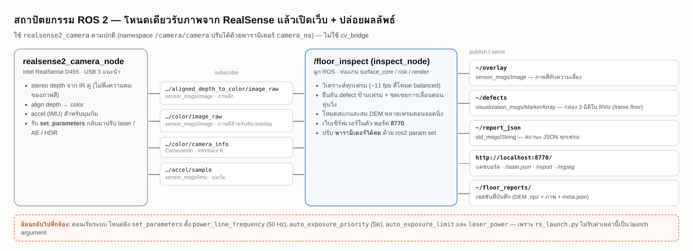</p>

**Subscribe** (ภายใต้ namespace `camera_ns` = `/camera/camera`):

| Topic | ชนิด | ใช้ทำอะไร |
|---|---|---|
| `…/aligned_depth_to_color/image_raw` | `sensor_msgs/Image` | ภาพลึก (aligned กับสี) |
| `…/color/image_raw` | `sensor_msgs/Image` | ภาพสีสำหรับทับ overlay |
| `…/color/camera_info` | `sensor_msgs/CameraInfo` | intrinsics K |
| `…/accel/sample` | `sensor_msgs/Imu` | มุมก้ม |

**Publish** (โหนดชื่อ `/floor_inspect`):

| Topic | ชนิด | เนื้อหา |
|---|---|---|
| `/floor_inspect/overlay` | `sensor_msgs/Image` | ภาพสีทับความเสี่ยง (`bgr8`) |
| `/floor_inspect/defects` | `visualization_msgs/MarkerArray` | กล่อง 3 มิติของ defect ใน frame `floor` (สีตามระดับ, ไม่เกิน 60 จุด) — ดูใน RViz |
| `/floor_inspect/report_json` | `std_msgs/String` | สถานะ JSON ทุกเฟรม (ชุดเดียวกับ `/state.json`) |

```bash
ros2 topic echo /floor_inspect/report_json --once
rviz2   # Add → MarkerArray → /floor_inspect/defects
```

> **เรื่อง TF:** marker ถูกวางใน frame ชื่อ `floor` (ต้นกำเนิด = ตีนตั้งฉากของกล้องบนพื้น, แกน z ชี้ขึ้นจากพื้น)
> แต่โหนด **ยังไม่ broadcast TF ของ frame นี้** — ถ้าจะดูใน RViz ต้องมี transform จากหุ่นไป `floor` เอง
> (เช่น `ros2 run tf2_ros static_transform_publisher 0 0 0 0 0 0 base_link floor` สำหรับดูคร่าว ๆ) แล้วตั้ง Fixed Frame ให้ตรงกัน

### พารามิเตอร์ (ปรับสดได้ทุกตัว: `ros2 param set /floor_inspect <ชื่อ> <ค่า>`)

<details>
<summary><b>ดูพารามิเตอร์ทั้งหมด (ค่าเริ่มต้น + ความหมาย)</b></summary>

| กลุ่ม | พารามิเตอร์ | ค่าเริ่มต้น | ความหมาย |
|---|---|---|---|
| **เกณฑ์ตรวจ** | `pothole_mm` | 4.0 | หลุมตื้นสุดที่รายงาน (mm) |
| | `bump_mm` | 4.0 | เนินเตี้ยสุดที่รายงาน |
| | `step_mm` | 3.0 | ลิ่ม/ขอบต่างระดับต่ำสุด |
| | `obstacle_mm` | 60.0 | สูงเท่านี้ขึ้นไปนับเป็น "สิ่งกีดขวาง" |
| | `min_snr` | 3.0 | SNR ขั้นต่ำของ defect |
| | `k_sigma` | 4.0 | เกณฑ์ = k × noise เซนเซอร์ |
| | `k_rough` | 3.0 | ความแรงของการกรองเนื้อผิว (พรม 3.0 · อีพ็อกซีมัน 1.5) |
| | `max_usable_mm` | 15.0 | เกินนี้ถือว่า "วัดไม่ได้แล้ว" ตัดออกจากพื้นที่สำรวจ |
| | `min_points_cell` | 6.0 | จุด depth ต่อเซลล์ขั้นต่ำ (0 = ปิด) — ตัวคุมจุดปลอมไกล ๆ |
| **กริด** | `cell_mm` | 10.0 | ขนาดเซลล์ DEM |
| | `zmax` | 3.0 | ตัดจุดที่ไกลกว่านี้ (m) |
| | `base_win_m` | 0.40 | ขนาดหน้าต่างฐานอ้างอิงเฉพาะที่ |
| | `pixel_stride` | 1 | 2 = ย่อ depth ก่อนวิเคราะห์ (เร็วขึ้น ~2 เท่า) |
| **ความนิ่ง** | `confirm_frames` / `confirm_hits` | 5 / 3 | ต้องโผล่ 3 ใน 5 เฟรมถึงรายงาน (`confirm_hits=1` = ปิด) |
| | `confirm_radius_m` | 0.10 | ถือเป็นจุดเดียวกันถ้าห่างไม่เกินนี้ |
| | `texture_alpha` | 0.30 | EMA ของเส้นเนื้อผิว (ต่ำ = นิ่งแต่ตามฉากช้า) |
| | `motion_compensate` | true | ชดเชยการเลื่อนตอนหุ่นวิ่ง (**อย่าปิดตอนวิ่ง**) |
| **หุ่น/การแสดงผล** | `amr_preset` | `amr_generic` | สเปกหุ่น |
| | `view_mode` | `risk` | `risk` \| `dev` |
| | `dev_vmax_mm` | 15.0 | ช่วงสีของโหมด `dev` |
| | `max_labels` | 8 | ป้ายข้อความสูงสุดบนภาพ (ที่เหลือขึ้นกากบาท) |
| | `profile_y_m` | 0.0 | ตำแหน่ง y ของภาพตัดขวาง |
| **สแกน** | `scan_frames` | 12 | จำนวนเฟรมที่สะสมในโหมดสแกน |
| | `interval` | 0.0 | 0 = เร็วสุด · >0 = จำกัดคาบ |
| **กล้อง** | `laser_power` | 150 | 0–360 |
| | `ae_limit_us` | 20000 | เพดานเวลาเปิดหน้ากล้อง depth (−1 = ไม่จำกัด) |
| | `hdr` | false | HDR สู้พื้นมันวาว |
| | `power_line_hz` | 50 | ไทย 50 Hz (0 = ปิด · −1 = ไม่ยุ่ง) |
| | `camera_ns` | `/camera/camera` | namespace กล้อง |
| | `stale_after_s` | 2.0 | ไม่มีเฟรมใหม่นานเกินนี้ = ประกาศว่ากล้องหยุดส่ง |

</details>

```bash
ros2 param set /floor_inspect pothole_mm 3.0
ros2 param set /floor_inspect amr_preset amr_small
ros2 param set /floor_inspect view_mode dev
ros2 param set /floor_inspect k_rough 3.0
```

### ค่ากล้องที่ตั้งให้อัตโนมัติตอนเริ่ม

`rs_launch.py` ไม่รับค่าเหล่านี้เป็น launch arg จึงยิงผ่าน service `set_parameters` ของกล้อง:

| ค่า | ตั้งเป็น | เหตุผล |
|---|---|---|
| `rgb_camera.power_line_frequency` | 1 (50 Hz) | ไทยใช้ไฟ 50 Hz — ถ้าปล่อย auto จะได้แถบมืด-สว่างไหลใต้หลอดฟลูออเรสเซนต์ |
| `rgb_camera.auto_exposure_priority` | false | ห้าม AE ยืดเวลาเปิดหน้ากล้องจนเฟรมเรตตกและภาพเบลอตอนหุ่นวิ่ง |
| `depth_module.auto_exposure_limit` | 20000 µs | จุดสะท้อนสว่างจ้าไม่ทำให้ AE ไล่ตามจน depth บานเป็นรู |
| `depth_module.laser_power` | 150 | ค่ากลาง ปรับด้วย `tune_camera` ตามผิวพื้นจริง |

### พื้นมันวาว / แสงสะท้อน — ตัวกวาดค่ากล้อง

ค่าที่ถูกไม่มีสูตรตายตัว ขึ้นกับผิวพื้นและมุมไฟของหน้างาน จึงมีตัวกวาดวัดผลจริง (`fill`, `rms`, `noise` ต่อค่า):

```bash
python3 -m floor_inspect.tune_camera           # กวาดแล้วรายงาน
python3 -m floor_inspect.tune_camera --apply   # กวาดแล้วตั้งค่าที่ดีที่สุดค้างไว้
```

> ตัวช่วยที่ได้ผลที่สุดกับพื้นมันวาวคือ **มุมกล้อง** ไม่ใช่พารามิเตอร์: ถ้าไฟสะท้อนเข้าเลนส์พอดี ให้ขยับมุมก้มหรือหมุนหุ่นสักหน่อย จุดสะท้อนจะเลื่อนออกทันที

### ฟิลด์ใน `/state.json` และ `~/report_json`

| ฟิลด์ | ความหมาย |
|---|---|
| `ready` · `ok` · `note` | พร้อมรับภาพ · วิเคราะห์ผ่านไหม · ข้อความอธิบายเมื่อไม่ผ่าน (เช่น "ยังไม่ได้เล็งพื้น") |
| `verdict` · `verdict_msg` | `OK`/`WATCH`/`SLOW`/`BLOCK` + ข้อความแนะนำ |
| `cam_height_m` · `tilt_deg` · `plane_rms_mm` · `inlier` · `fill` | การเล็งกล้อง: ความสูง · มุมก้ม · rms ของระนาบ · สัดส่วน inlier · สัดส่วนพิกเซลที่ได้ depth |
| `noise_mm` · `rough_mm` · `detectable_mm` | noise · เนื้อผิวของพื้น · **เล็กสุดที่ยืนยันได้** |
| `area_m2` · `coverage` · `ok_pct` · `worst` | พื้นที่สำรวจ · สัดส่วนครอบคลุม · % พื้นที่ผ่านเกณฑ์ · คะแนนความเสี่ยงสูงสุด |
| `FF` · `FF_class` · `FL` · `gap2m_mm` | ดัชนี ASTM E1155 และช่องใต้ไม้บรรทัด 2 m |
| `n_defects` · `defects[]` | จำนวนและรายการ (สูงสุด 40 จุด เรียงตามความเสี่ยง) |
| `spec` · `mode` · `scan_progress` · `fps` · `stale_s` | สเปกหุ่น · `live`/`scan` · ความคืบหน้าสแกน · fps · เวลาที่กล้องเงียบ |

แต่ละ `defects[]` มี: `kind`, `x`, `y`, `length_m`, `width_m`, `area_m2`, `peak_mm`, `mean_mm`, `cells`, `edge_step_mm`,
`noise_mm`, `snr`, `range_m`, `risk`, `risk_score`, `safe_speed_ms`, `reason`

---

## บันทึกเซสชัน · replay · ป้ายกำกับ

กด **บันทึกเซสชัน** บนแดชบอร์ด → ได้โฟลเดอร์ใน `~/floor_reports/` (เปลี่ยนด้วย env `FLOOR_INSPECT_OUT`):

```text
20260825_103803_carpet_after/
├── meta.json          เงื่อนไขการวัด + defect ทั้งหมด + คำตัดสิน
├── dem.npz            DEM ดิบ (z, count, spread, ระนาบ, T_floor_cam)
├── color.png          ภาพสีขณะนั้น
├── overlay.png        ภาพ overlay
├── topdown.png        แผนที่มองจากบน
├── topdown_risk.png   แผนที่ความเสี่ยงมองจากบน
└── profile.png        ภาพตัดขวาง
```

เปิดกลับมาวิเคราะห์ซ้ำ **โดยไม่ต้องกลับไปหน้างานและไม่ต้องมีกล้อง** — ใน repo มีเซสชันจริงตัวอย่างให้ลอง
([`examples/session_carpet`](examples/session_carpet): พรม + ของวางจริง):

```bash
# วิเคราะห์ซ้ำด้วยเกณฑ์เดิม → ได้ report_replay.md
python3 -m floor_inspect.cli replay examples/session_carpet --out ./replay_default.md
# วิเคราะห์ซ้ำด้วยเกณฑ์หลุม 20 mm + หุ่นเล็ก
python3 -m floor_inspect.cli replay examples/session_carpet --pothole-mm 20 --amr amr_small --out ./replay_carpet.md
```

> ผลที่รันได้จริง: เกณฑ์ 4 mm → 8 จุด · เกณฑ์ 20 mm → **4 จุด** (หลุมผีบนพรมหายไป ของวางจริงยังอยู่)
> ตัวเลข replay อาจต่างจากหน้าเว็บสดเล็กน้อย เพราะ replay วิเคราะห์จาก DEM ที่บันทึกแล้ว ไม่มีขั้นยืนยันข้ามเฟรม

**ป้ายกำกับ:** ปุ่ม ✓ / ✕ ในตารางหน้าเว็บบันทึกลง `annotations.csv` → คำนวณ precision/recall ของระบบกับการตรวจของคนได้
(แนวทางเดียวกับ `cloud_annotation_tool` / `flobotAnnotator` ของโครงการ FLOBOT)

---

## เรียกใช้เป็นไลบรารี Python

แกนวิเคราะห์ไม่ผูก ROS — ป้อนภาพลึก (mm) + intrinsics ได้เลย (ตัวอย่างนี้รันผ่านจริงใน repo; ใช้ฉากจำลองแทนกล้อง):

```python
from floor_inspect import synth, surface_core as sc, risk as rk

# 1) depth image (mm) + intrinsics K = (fx, fy, cx, cy)  — ที่นี่ใช้ฉากจำลอง
scene = synth.SCENES['warehouse']()
cam = synth.CameraSpec(height_m=0.6, pitch_deg=45.0)
depth_mm, K, _ = synth.render_depth(scene, cam)

# 2) วิเคราะห์พื้น
params = sc.SurfaceParams(cell=0.010, pothole_mm=4.0, bump_mm=4.0)
res = sc.analyse_depth(depth_mm, K, params)
assert res.ok, res.note

# 3) ตัดสินความเสี่ยงสำหรับหุ่นรุ่นที่เลือก
spec = rk.PRESETS['amr_generic']
rk.assess_all(res.defects, spec)
grid = rk.risk_grid(res.dem, res.dev_local_mm, res.steps_mm, res.slope_deg,
                    spec, res.noise_mm, rough_mm=res.rough_mm)

print(f'เล็กสุดที่ยืนยันได้ {res.detectable_mm:.2f} mm, พื้นที่ {res.dem.area_m2:.2f} m²')
for d in sorted(res.defects, key=lambda d: -d.risk_score)[:3]:
    print(d.kind, f'{d.peak_mm:+.1f} mm', d.risk, f'{d.safe_speed_ms:.2f} m/s')
```

```text
เล็กสุดที่ยืนยันได้ 2.86 mm, พื้นที่ 1.68 m²
pothole -8.3 mm block 0.45 m/s
step +5.6 mm slow 0.21 m/s
step +4.7 mm watch 0.23 m/s
```

ต่อเป็นรายงาน/ภาพได้ด้วย `floor_inspect.render` (overlay / topdown / profile) และ `floor_inspect.report`
(`markdown_report`, `figure_png`) ตามตัวอย่างใน [`cli.py`](floor_inspect/cli.py) (`cmd_demo`)

---

## โครงสร้างโปรเจกต์

repo นี้คือ **ROS 2 package ตัวเดียว** (`ament_python`) — clone ลง `src/` แล้ว `colcon build` ได้เลย

```text
floor-inspect/
├── README.md                 ← ไฟล์นี้
├── package.xml · setup.py    ROS 2 package (entry points: inspect_node, floor_inspect)
├── requirements.txt          dependency ฝั่ง Python
├── launch/inspect.launch.py  เปิดกล้อง D455 + โหนดวิเคราะห์พร้อมกัน
├── scripts/
│   ├── run_floor_inspect.sh  สั่งเดียวเปิดทั้งระบบ (ตรวจ USB, ล้างโหนดเก่า, launch)
│   ├── aim_check.sh          ตัวช่วยเล็งกล้อง (พิมพ์สถานะสดทุกครึ่งวินาที)
│   └── _aim_line.py
├── floor_inspect/            โค้ดหลัก
├── test/                     เทสต์ 44 ข้อ + ข้อมูลกล่องจริงจากกล้อง (test/data)
├── examples/session_carpet/  เซสชันจริงตัวอย่าง (ใช้กับ replay)
└── docs/
    ├── TECHNICAL_NOTES.md    บันทึกเชิงลึก: วัดอะไร ผิดตรงไหน แก้อย่างไร
    ├── sample_report.md      ตัวอย่างรายงานที่ระบบสร้าง
    └── images/               ภาพประกอบทั้งหมดใน README
```

| ไฟล์ใน `floor_inspect/` | หน้าที่ | ผูกกับ ROS |
|---|---|---|
| `surface_core.py` | ระนาบ → DEM → ค่าเบี่ยงเบน → รายการ defect | ไม่ |
| `fnumbers.py` | ASTM E1155 FF/FL + ช่องใต้ไม้บรรทัด TR34 | ไม่ |
| `risk.py` | มิลลิเมตร → "หุ่นผ่านได้ไหม" ด้วยเรขาคณิตล้อ + preset หุ่น | ไม่ |
| `render.py` | overlay / แผนที่มองจากบน / ภาพตัดขวาง (ข้อความไทยด้วย PIL) | ไม่ |
| `synth.py` | สนามทดสอบจำลองพร้อมเฉลย (ray marching) | ไม่ |
| `evaluate.py` | วัดความแม่นเทียบเฉลย → ตารางขอบเขตใช้งาน | ไม่ |
| `session.py` | บันทึก / เปิดซ้ำ / annotate | ไม่ |
| `report.py` | รายงาน Markdown + รูปประกอบ | ไม่ |
| `cli.py` | `demo` · `bench` · `replay` | ไม่ |
| `inspect_node.py` | โหนดสด + แดชบอร์ดเว็บ | **ใช่** |
| `dashboard_html.py` | หน้าเว็บ (HTML ฝังในโค้ด) | ไม่ |
| `tune_camera.py` | กวาดค่าตั้งกล้องแล้ววัดผลจริง (สู้แสงสะท้อน) | **ใช่** |

แกนทั้งหมดไม่ผูกกับ ROS → ทดสอบและพัฒนาได้โดยไม่ต้องมีกล้องหรือ ROS

---

## ทดสอบ

```bash
cd floor-inspect
python3 -m pytest test/ -v        # 44 ข้อ ใช้เวลา ~2 นาที (รันครั้งล่าสุด: 44 passed)
```

เทสต์ไม่ได้แค่เช็คว่ารันผ่าน แต่ **ล็อกพฤติกรรมที่เคยพังจริง** เช่น

| กลุ่ม | ตัวอย่างสิ่งที่ล็อกไว้ |
|---|---|
| เรขาคณิต | ray-casting ตรงกับ height field · ระนาบ fit คืนความสูงกล้องถูก · ลาดเอียง 1 องศาวัดถูกเป๊ะ |
| ความแม่น | ไม่มี false positive บนพื้นเรียบ · วัดความลึกไม่เอนเอียง · สะสมเฟรมแล้วแม่นขึ้น |
| ฟิสิกส์ล้อ | ล้อคร่อมร่องแคบ · ร่องแคบลึกเสี่ยงน้อยกว่าแอ่งกว้างตื้น · caster เล็กกว่าเข้มกว่า |
| พื้นมีเนื้อผิว | พื้นหยาบไม่ท่วมด้วย defect ปลอม แต่หลุมจริงยังรอด · เนื้อผิวโตตามระยะ |
| ความนิ่ง | กริด DEM ล็อกเฟส · เซลล์ข้อมูลบางไม่ถูกเชื่อ · ค่า fit นิ่งข้ามเฟรม |
| ตอนหุ่นวิ่ง | กล้องเคลื่อนแล้วของจริงไม่หาย · การชดเชยเลื่อนคือตัวที่ทำให้ต่าง · เฟรมวัดเลื่อนไม่ได้แล้วถอยไปรายงานทุกเฟรม |
| ข้อมูลจริง | กล่องสูง ~35 cm จากกล้องจริง (`test/data/box_355mm.npz`) รายงานความสูงจากพื้น ไม่แตกเป็นหลายก้อน |
| พื้นขรุขระ | ยางมะตอยหยาบ ~2 mm / คอนกรีตสึก ~1 mm: เจอทุกหลุม ชนิดถูก คลาด < 4 mm ไม่มีจุดปลอมนอกเฉลย (ยอมเนินติดขอบหลุมขอบชันได้ 1 จุด) |
| ผิวสะท้อน | ผิวกระจกถูกเรียกชื่อ ไม่ถูกโทษว่าเล็งผิด · พื้นปกติไม่ถูกเรียกว่าผิวกระจก |

> เทสต์เรื่องกล่องใช้ **เฟรมจากกล้องจริง** เพราะตัวจำลองสร้างอาการนี้ไม่ได้ — เคยเขียนเวอร์ชันจำลองแล้วพบว่า "ผ่านทั้งที่ปิดการแก้ทิ้ง" จึงเปลี่ยนมาใช้ของจริง

---

## แก้ปัญหาที่เจอบ่อย

| อาการ | สาเหตุ | วิธีแก้ |
|---|---|---|
| สคริปต์บอก **"ไม่พบ RealSense บนพอร์ต USB"** | ไม่ได้เสียบ / สายเป็นแบบ charge-only | เสียบสาย USB-C เข้าพอร์ต USB 3 (ช่องสีฟ้า/มี SS) · ลองสลับสาย |
| เตือน **"ต่ออยู่แบบ USB 2"** | พอร์ต/สายเป็น USB 2 | ยังใช้ได้ (640×480@15) แต่พื้นที่ต่อเฟรมแคบและ fps ต่ำ — ย้ายไปพอร์ต USB 3 |
| หน้าเว็บค้างที่ **"กำลังรอภาพจากกล้อง…"** | โหนดไม่ได้รับ depth | ดู `ros2 topic hz /camera/camera/aligned_depth_to_color/image_raw` · เช็ค `camera_ns` · `curl localhost:8770/state.json` |
| **"ยังไม่ผ่าน"** ใน `aim_check` (rms สูง / inlier ต่ำ) | กล้องเล็งผนัง/กองของ ไม่ใช่พื้น | ก้มกล้องลงจนขึ้น `พร้อม` (rms < 12 mm และ inlier > 0.6) |
| ขึ้น **"ผิวสะท้อนแบบกระจก"** | พื้นเคลือบเงามาก — กล้องเห็นแต่เงาสะท้อนห้อง | ไม่มีค่ากล้องแก้ได้ ปูกระดาษ/เทปด้านบนผิว หรือดับไฟที่สะท้อน |
| `fill` ต่ำทั้งที่เล็งพื้น / depth เป็นรู | แสงสะท้อน | `GLARE=1` · `python3 -m floor_inspect.tune_camera --apply` · ขยับมุมกล้องเล็กน้อย |
| พรมเรียบแต่ได้ **"หลุมผี"** หลายจุด | หางหนาของ stereo noise บนพรม | `CARPET=1` (หลุม 20 mm) — หรือลดระยะกล้องเข้าใกล้ขึ้น |
| แบนเนอร์แดง **"กล้องหยุดส่งภาพ"** | USB 2 แบนด์วิดท์ล้ม / ไดรเวอร์ค้าง | รันสคริปต์ใหม่ · ถอดเสียบสาย แล้วใช้พอร์ต USB 3 |
| ตัวอักษรไทยบนภาพเป็นสี่เหลี่ยม □ | ไม่มีฟอนต์ไทย | `sudo apt install fonts-tlwg-loma-ttf` |
| พอร์ต 8770 ถูกใช้อยู่ | โหนดเก่าค้าง | สคริปต์ล้างให้เอง · หรือเปลี่ยนด้วย `FLOOR_INSPECT_PORT=8771` |
| `cv_bridge` / OpenCV ชนกัน | OpenCV ใหม่จาก pip ชน `cv_bridge` | โปรเจกต์นี้ไม่ใช้ `cv_bridge` — ไม่กระทบ |
| ยังไม่มีกล้อง อยากลองก่อน | — | `python3 -m floor_inspect.cli demo` · หรือ `replay examples/session_carpet` |

---

## อ้างอิง

- ASTM E1155 / E1155M — *Standard Test Method for Determining FF Floor Flatness and FL Floor Levelness Numbers*
- Concrete Society TR34 / ACI 117 — เกณฑ์ช่องใต้ไม้บรรทัด (straightedge gap)
- Warehouse floor flatness testing with laser scanning / LiDAR — deviation heat map, grind map, F-number report
- Wilson, Potgieter & Arif, *Robot-Assisted Floor Surface Profiling Using Low-Cost Sensors*, Remote Sensing 2019, 11(22), 2626
- FLOBOT (EU H2020 #645376) — กล้อง RGB-D มองพื้น + ground plane estimation + dirt detection

---

<div align="center">
  <sub>MIT License · สร้างเพื่อ AMR ที่วิ่งบนพื้นจริง ไม่ใช่พื้นในตำรา</sub>
</div>
